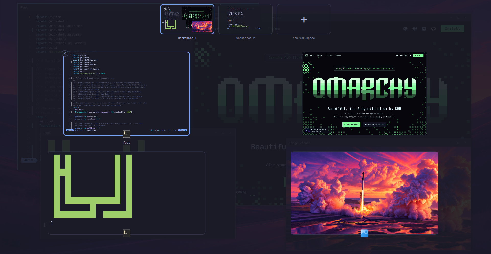
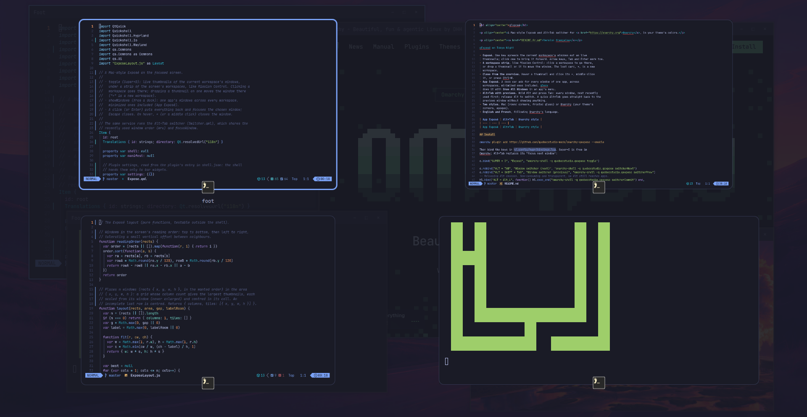
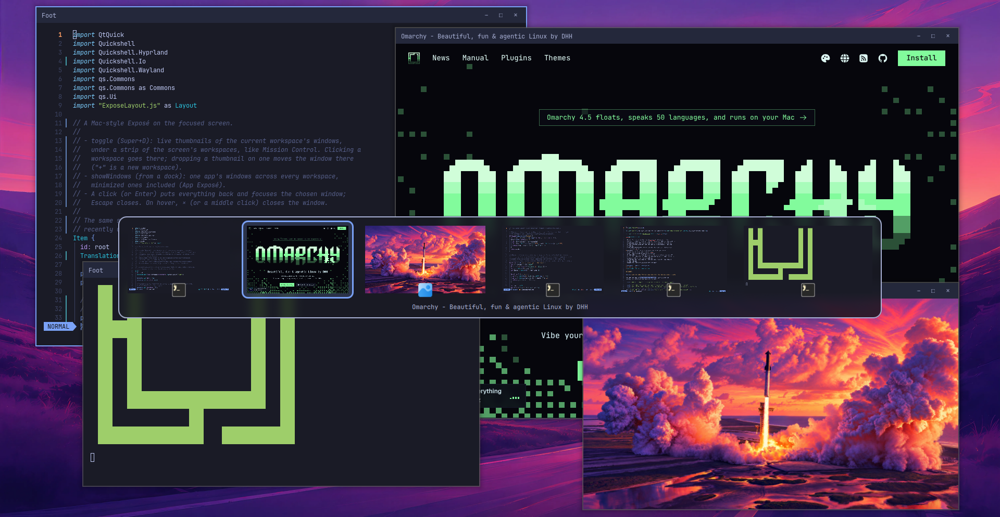
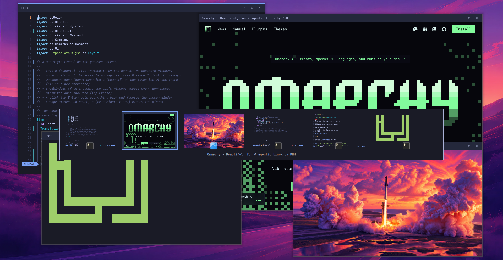

<p align="center">
  
</p>

<h1 align="center">qExposé</h1>

<p align="center">Un Exposé et un sélecteur Alt+Tab façon Mac pour <a href="https://omarchy.org">Omarchy</a>, aux couleurs de votre thème.</p>

<p align="center"><a href="README.md">English version</a></p>



**Vous venez de macOS ?** qExposé, c'est Exposé et Mission Control, App Exposé compris, et
un sélecteur d'apps comme Commande-Tab qui montre les fenêtres elles-mêmes, comme Alt+Tab sous
Windows. Il va avec [qDock](https://github.com/quebecstudio-mods/omarchy-qdock), le Dock, et [qCenter](https://github.com/quebecstudio-mods/omarchy-qcenter), le centre de
notifications.

- **Exposé.** Une touche étale les fenêtres du bureau courant en miniatures en
  direct ; un clic ramène celle qu'on veut. Les flèches, Tab et Entrée marchent
  aussi.
- **Une bande des bureaux**, comme Mission Control : un clic sur un bureau y va,
  et une miniature déposée dessus y déplace la fenêtre. La dernière carte,
  **+**, est un nouveau bureau.
- **Taper pour filtrer.** Commencez à taper dans Exposé : seules restent les
  fenêtres dont le titre ou l'app correspond. Retour arrière efface, Échap vide
  le filtre, Entrée ouvre la fenêtre choisie.
- **Fermer depuis la vue d'ensemble.** Survolez une miniature et cliquez son ×,
  cliquez-la du bouton du milieu, ou faites Ctrl+W.
- **App Exposé.** Un dock peut demander toutes les fenêtres d'une app, tous
  bureaux confondus, réduites comprises. [qDock](https://github.com/quebecstudio-mods/omarchy-qdock)
  le fait avec **Afficher toutes les fenêtres** dans le menu d'une app.
- **Alt+Tab avec aperçus.** Maintenez Alt et appuyez sur Tab : toutes les
  fenêtres, la plus récemment utilisée d'abord ; relâchez Alt pour y aller. Un
  Alt+Tab rapide revient directement à la fenêtre précédente, sans rien
  afficher.
- **Quatre styles**, ceux de qDock : Omarchy (coins du thème, opaque),
  Cupertino (coins arrondis, verre givré), Redmond (comme Windows) et Plasma
  (comme KDE). Avec qDock installé, qExposé suit le style de qDock, sauf si vous
  lui donnez le sien.
- **En anglais et en français**, selon la langue d'Omarchy.

| App Exposé | Alt+Tab | Style Omarchy |
| --- | --- | --- |
|  |  |  |

## Installation

```bash
omarchy plugin add https://github.com/quebecstudio-mods/omarchy-qexpose --enable
```

Omarchy affiche d'abord un avertissement de sécurité et demande de confirmer
(*Clone and add this plugin?*) ; ajoutez `--yes` pour sauter la question dans un
script.

Liez ensuite les touches dans `~/.config/hypr/bindings.lua`. Super+D est libre
dans Omarchy ; Alt+Tab remplace son « fenêtre suivante » :

```lua
o.bind("SUPER + D", "Exposé", "omarchy-shell -q quebecstudio.qexpose toggle")

o.rebind("ALT + TAB", "Window switcher (next)", "omarchy-shell -q quebecstudio.qexpose switcherNext")
o.rebind("ALT + SHIFT + TAB", "Window switcher (previous)", "omarchy-shell -q quebecstudio.qexpose switcherPrev")
-- Le relâchement d'Alt choisit. Non consommé et transparent : Alt arrive toujours aux apps.
hl.bind("ALT + Alt_L", function() hl.exec_cmd("omarchy-shell -q quebecstudio.qexpose switcherCommit") end,
  { description = "Window switcher (choose on Alt release)", release = true, non_consuming = true, ignore_mods = true, transparent = true })
```

### Verre givré

En styles Cupertino, Redmond et Plasma, le panneau Alt+Tab est translucide. Pour le flou derrière,
ajoutez cette règle à `~/.config/hypr/hyprland.lua` :

```lua
hl.layer_rule({ match = { namespace = "^qexpose-switcher$" }, blur = true, ignore_alpha = 0.2 })
```

## Réglages

Dans l'entrée de qExposé sous `plugins`, dans `~/.config/omarchy/shell.json` :

```json
{ "id": "quebecstudio.qexpose", "style": "omarchy" }
```

| Réglage | Valeurs | Par défaut |
| --- | --- | --- |
| `style` | `"omarchy"`, `"cupertino"`, `"redmond"`, `"plasma"` (`"mac"`, le nom de la 1.0, se lit encore `"cupertino"`) | le style de qDock, ou `"cupertino"` sans qDock |

## Commandes

```bash
omarchy-shell -q quebecstudio.qexpose toggle    # Exposé sur l'écran actif
omarchy-shell -q quebecstudio.qexpose open
omarchy-shell -q quebecstudio.qexpose close
omarchy-shell -q quebecstudio.qexpose showWindows '["0x55d0c0a1b2c0"]'   # App Exposé : liste JSON d'adresses de fenêtres
omarchy-shell -q quebecstudio.qexpose switcherNext     # Alt+Tab : ouvrir, ou avancer
omarchy-shell -q quebecstudio.qexpose switcherPrev
omarchy-shell -q quebecstudio.qexpose switcherCommit   # aller à la fenêtre choisie
omarchy-shell -q quebecstudio.qexpose switcherCancel
```

Les adresses des fenêtres viennent de `hyprctl clients -j`.

## Licence

MIT © Québec Studio

macOS, Finder, Launchpad, Mission Control et Exposé sont des marques d'Apple Inc. ; Windows est une marque de Microsoft Corporation ; KDE et Plasma sont des marques de KDE e.V. Ce projet n'est ni affilié à ces sociétés ni approuvé par elles.
