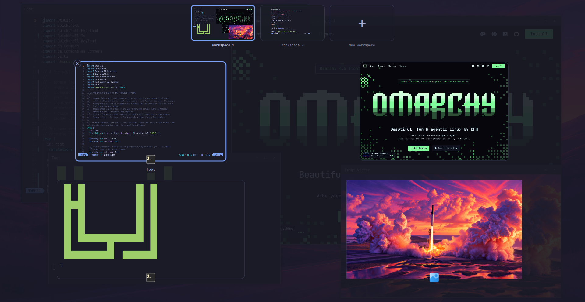
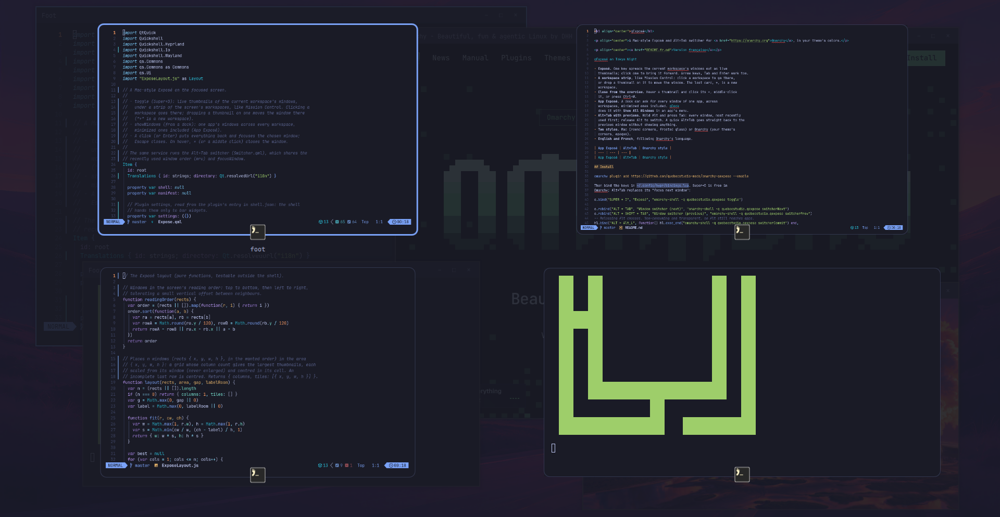
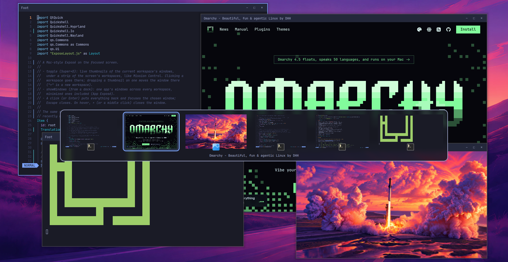
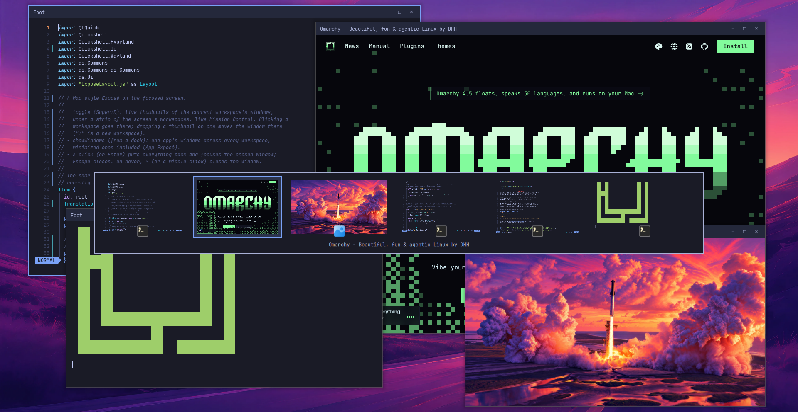

<p align="center">
  
</p>

<h1 align="center">qExposé</h1>

<p align="center">A Mac-style Exposé and Alt+Tab switcher for <a href="https://omarchy.org">Omarchy</a>, in your theme's colors.</p>

<p align="center"><a href="README.fr.md">Version française</a></p>



**Coming from macOS?** qExposé is Exposé and Mission Control, App Exposé included, and
an app switcher like Command-Tab that shows the windows themselves, as Alt+Tab does on
Windows. It pairs with [qDock](https://github.com/quebecstudio-mods/omarchy-qdock), the Dock, and [qCenter](https://github.com/quebecstudio-mods/omarchy-qcenter), the
Notification Center.

- **Exposé.** One key spreads the current workspace's windows out as live
  thumbnails; click one to bring it forward. Arrow keys, Tab and Enter work too.
- **A workspace strip**, like Mission Control: click a workspace to go there,
  or drop a thumbnail on it to move the window. The last card, **+**, is a new
  workspace.
- **Close from the overview.** Hover a thumbnail and click its ×, middle-click
  it, or press Ctrl+W.
- **App Exposé.** A dock can ask for every window of one app, across
  workspaces, minimized ones included. [qDock](https://github.com/quebecstudio-mods/omarchy-qdock)
  does it with **Show All Windows** in an app's menu.
- **Alt+Tab with previews.** Hold Alt and press Tab: every window, most recently
  used first; release Alt to switch. A quick Alt+Tab goes straight back to the
  previous window without showing anything.
- **Two styles.** Mac (round corners, frosted glass) or Omarchy (your theme's
  corners, opaque).
- **English and French**, following Omarchy's language.

| App Exposé | Alt+Tab | Omarchy style |
| --- | --- | --- |
|  |  |  |

## Install

```bash
omarchy plugin add https://github.com/quebecstudio-mods/omarchy-qexpose --enable
```

Then bind the keys in `~/.config/hypr/bindings.lua`. Super+D is free in
Omarchy; Alt+Tab replaces its "focus next window":

```lua
o.bind("SUPER + D", "Exposé", "omarchy-shell -q quebecstudio.qexpose toggle")

o.rebind("ALT + TAB", "Window switcher (next)", "omarchy-shell -q quebecstudio.qexpose switcherNext")
o.rebind("ALT + SHIFT + TAB", "Window switcher (previous)", "omarchy-shell -q quebecstudio.qexpose switcherPrev")
-- Releasing Alt chooses. Non-consuming and transparent, so Alt still reaches apps.
hl.bind("ALT + Alt_L", function() hl.exec_cmd("omarchy-shell -q quebecstudio.qexpose switcherCommit") end,
  { description = "Window switcher (choose on Alt release)", release = true, non_consuming = true, ignore_mods = true, transparent = true })
```

### Frosted glass

In the Mac style, the Alt+Tab panel is translucent. For the blur behind it, add
this rule to `~/.config/hypr/hyprland.lua`:

```lua
hl.layer_rule({ match = { namespace = "^qexpose-switcher$" }, blur = true, ignore_alpha = 0.2 })
```

## Settings

In qExposé's entry under `plugins` in `~/.config/omarchy/shell.json`:

```json
{ "id": "quebecstudio.qexpose", "style": "omarchy" }
```

| Setting | Values | Default |
| --- | --- | --- |
| `style` | `"mac"`, `"omarchy"` | `"mac"` |

## Commands

```bash
omarchy-shell -q quebecstudio.qexpose toggle    # Exposé on the focused screen
omarchy-shell -q quebecstudio.qexpose open
omarchy-shell -q quebecstudio.qexpose close
omarchy-shell -q quebecstudio.qexpose showWindows '["0x55d0c0a1b2c0"]'   # App Exposé: a JSON list of window addresses
omarchy-shell -q quebecstudio.qexpose switcherNext     # Alt+Tab: open, or move on
omarchy-shell -q quebecstudio.qexpose switcherPrev
omarchy-shell -q quebecstudio.qexpose switcherCommit   # switch to the chosen window
omarchy-shell -q quebecstudio.qexpose switcherCancel
```

Window addresses come from `hyprctl clients -j`.

## License

MIT © Québec Studio

macOS, Finder, Launchpad, Mission Control and Exposé are trademarks of Apple Inc. This project is not affiliated with or endorsed by Apple.
